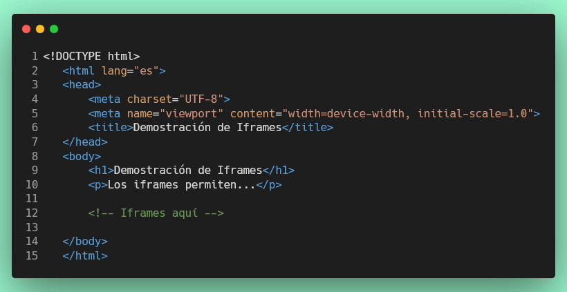

# Ejercicio 2: Iframe de Video (YouTube)

## 📋 Cómo visualizar tu ejercicio

Para visualizar tus archivos HTML mientras trabajas:

1. **Instalar Live Server** (si no lo tienes):
   - Ve a las extensiones de VS Code (Ctrl+Shift+X)
   - Busca "Live Server" de Ritwick Dey
   - Haz clic en instalar

2. **Usar Live Server**:
   - Abre el archivo `src/index.html`
   - Haz clic derecho en el archivo
   - Selecciona "Open with Live Server"
   - El navegador se abrirá automáticamente
   - Navega a tu ejercicio desde el menú

3. **Actualización automática**:
   - Guarda tus cambios (Ctrl+S)
   - El navegador se actualizará automáticamente

## Objetivo

Aprender a incrustar videos de plataformas como YouTube usando iframes, configurando atributos especiales para videos como `allowfullscreen` y comprendiendo las URLs de embed.

## 🎯 Conceptos a evaluar:

- Incrustación de videos con iframe
- URLs de embed de YouTube
- Atributo `allowfullscreen` para modo pantalla completa
- Múltiples iframes en una misma página
- Organización de contenido con encabezados

### Documentación
[Material didáctico sobre iframes](https://webtecnodidacticahoy.web.app/html/Multimedia_e_insercion/iframes_en_detalle.html)

## Instrucciones

1. Este ejercicio se creará dentro de la carpeta `src/ejercicio-2`.

2. Crear un archivo `index.html` ubicado en la carpeta `src/ejercicio-2`.

3. Agregar los siguientes elementos a tu documento HTML:
   
   **Estructura básica HTML5:**
   - Declaración `<!DOCTYPE html>`
   - Elemento `<html>` con atributo `lang="es"`
   - Elemento `<head>` con:
     - Meta tag charset UTF-8
     - Meta tag viewport para responsividad
     - Título apropiado en la etiqueta `<title>`
   - Elemento `<body>` con el contenido

4. **Dentro del body, agregar:**
   - Un encabezado principal de nivel 1 (h1) con el texto "Iframes de Video"
   - Un párrafo introductorio explicando el propósito de la página

5. **Implementar DOS iframes de video con los siguientes requisitos:**

   **Primer iframe (Video de YouTube):**
   - URL de origen (src): `https://www.youtube.com/embed/iFToyCXIktE?si=jqYtMwwI6d4OM-xI`
   - Atributo `title` con descripción apropiada del video
   - Ancho (width): 560
   - Alto (height): 315
   - Atributo `allowfullscreen` (sin valor, es un atributo booleano)

   **Segundo iframe (Otro video):**
   - URL de origen de otro video de YouTube o Vimeo (debe ser URL de embed)
   - Atributo `title` con descripción apropiada
   - Dimensiones apropiadas (width y height)
   - Atributo `allowfullscreen`

6. **Agregar encabezados h2** antes de cada iframe para identificar cada video

7. **Ejemplo de estructura esperada:**

```
src/
└── ejercicio-2/
    └── index.html
```

## Requisitos Técnicos

- **Solo HTML**: No usar CSS ni JavaScript
- **Estructura válida**: Documento HTML5 bien formado
- **Accesibilidad**: Todos los iframes deben tener atributo `title` descriptivo
- **URLs seguras**: Usar HTTPS en todos los src
- **URLs de embed**: Usar URLs específicas de embed (youtube.com/embed/, vimeo.com/video/, etc.)

## Verificación

Para verificar que tu solución es correcta, ejecuta:

```bash
npm test tests/ejercicio/2-iframe-video.test.js
```

Si todos los tests pasan (✓), tu ejercicio está completo y correcto.

## Conceptos Clave

- **URL de embed**: Las plataformas de video como YouTube proporcionan URLs especiales para incrustar videos que terminan en `/embed/VIDEO_ID`
- **Atributo allowfullscreen**: Permite que el usuario pueda ver el video en modo pantalla completa
- **Dimensiones estándar**: Los videos de YouTube suelen usar 560x315 o 640x360 para mantener la proporción 16:9

## Ejemplo de código



## Notas importantes

- Para obtener la URL de embed de un video de YouTube:
  1. Ve al video en YouTube
  2. Haz clic en "Compartir"
  3. Selecciona "Insertar" o "Embed"
  4. Copia la URL que aparece en el atributo `src` del iframe

¡Buena suerte y diviértete programando!
